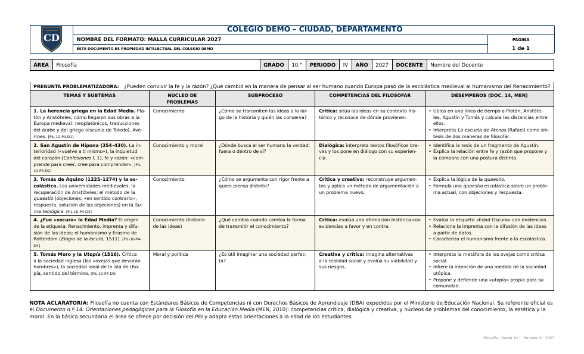
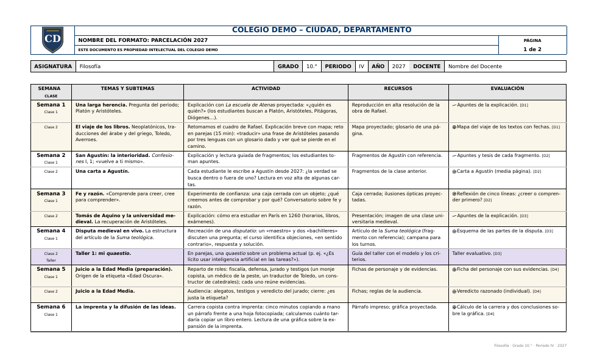
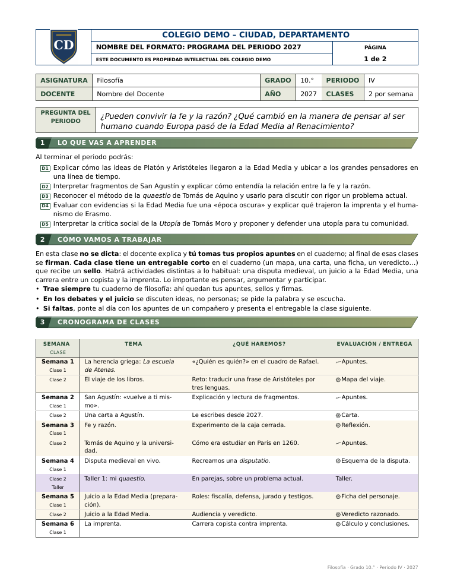
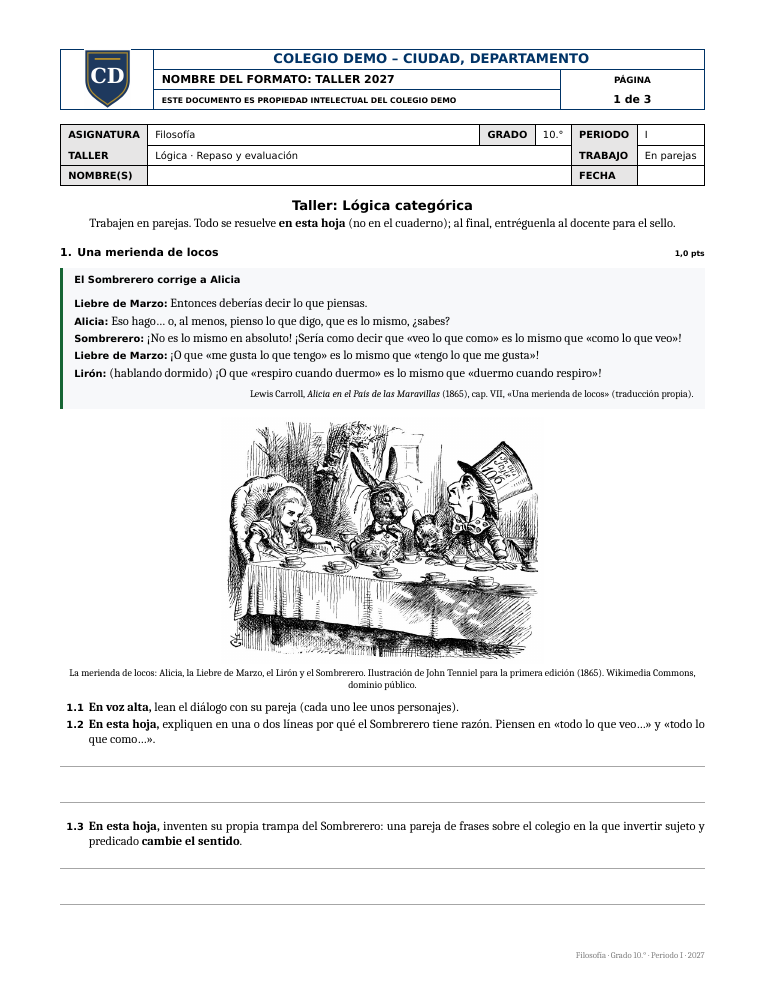
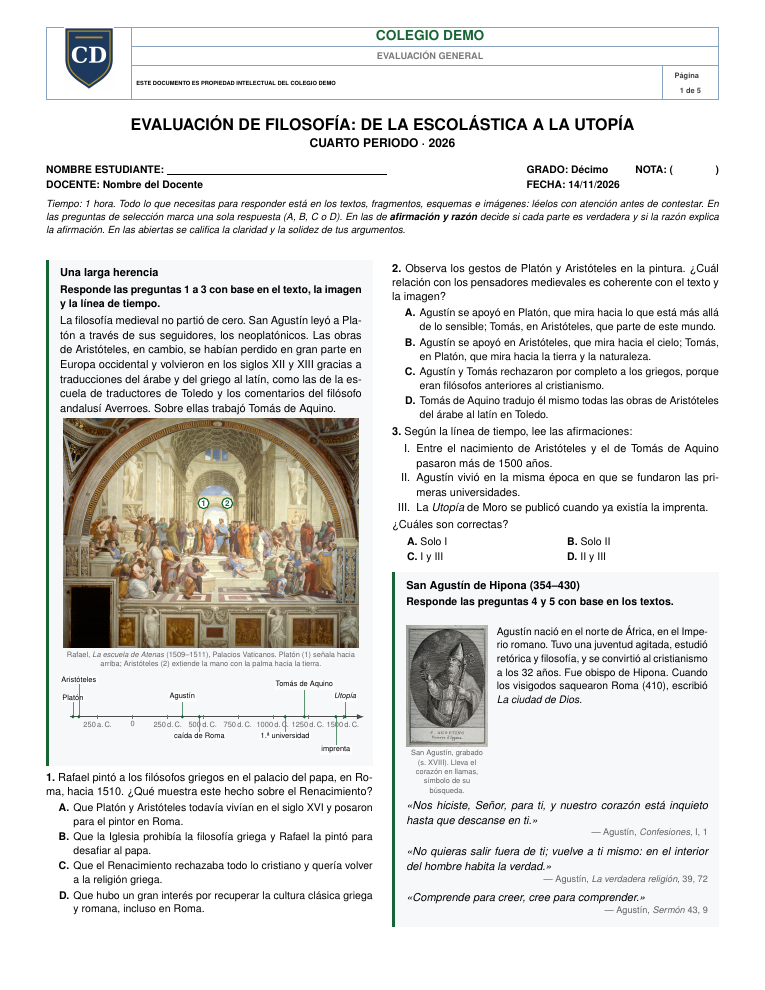
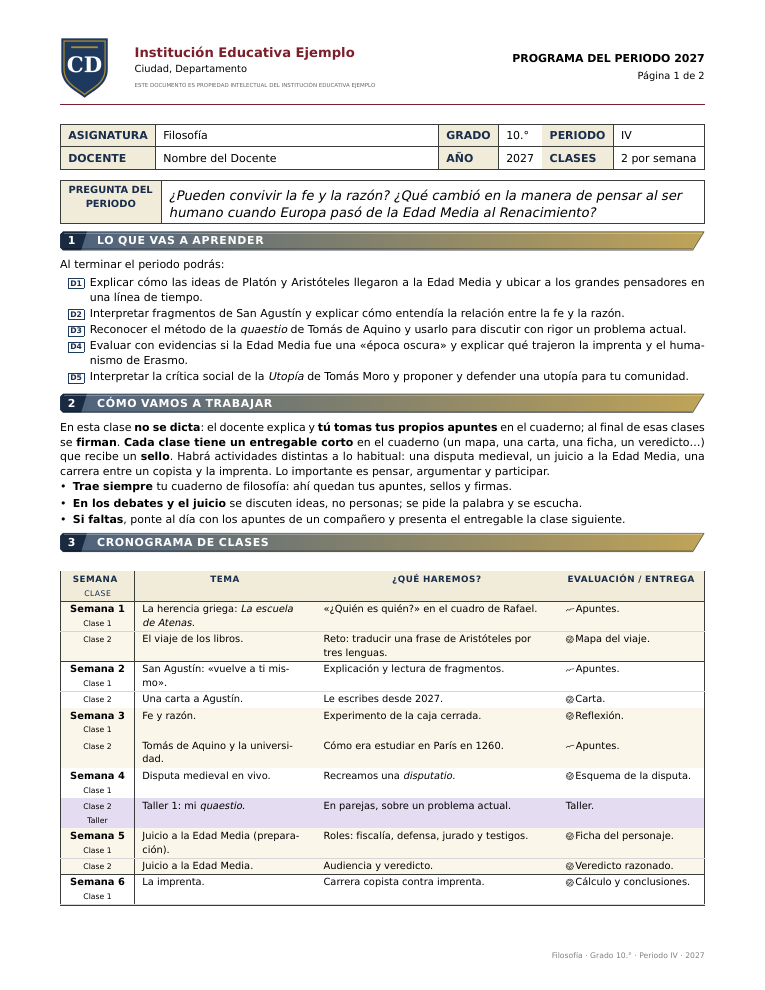

# docencia-ia

**Skills de Claude para planear un periodo escolar completo con rigor: de la malla curricular a la
habilitación.** Un docente dice qué se vio en clase y Claude produce los documentos en PDF, con el
formato del colegio: malla, parcelación por clases, programa para estudiantes y acudientes,
talleres, quiz, evaluación de periodo y plan de habilitación. Los conecta todos por los mismos
desempeños y los revisa antes de entregarlos.

Funciona en **Claude Code** (flujo completo: compila, revisa, versiona y sube a Google Drive) y en
**claude.ai** (skills empaquetadas en `recursos/skills/`). Se adapta a **cualquier colegio**
editando dos archivos de configuración: nombre, logo, colores, estilo de encabezado y perfil
pedagógico del docente.

| Malla curricular | Parcelación por clases |
|---|---|
|  |  |

| Programa del periodo | Taller | Evaluación |
|---|---|---|
|  |  |  |

*Todo sale del piloto incluido (Filosofía 10.°, periodo IV), compilado con el «Colegio Demo».*

---

## El problema

Planear bien un periodo exige mucho trabajo de escritorio. Hay que hacer la malla con el referente
oficial, repartir los temas clase por clase, redactar un programa que entiendan estudiantes y
familias, preparar talleres con material real, hacer pruebas tipo Saber con buenos distractores y
cerrar con la habilitación. Cada pieza se hace por separado, en Word, y casi nunca habla con las
demás.

La IA generativa puede ayudar, pero sola es peligrosa en un aula:
- **inventa temarios y citas**;
- produce material **genérico y «con cara de IA»**;
- y diseña actividades que **un estudiante puede resolver con otro chatbot** sin haber ido a clase.

## La propuesta: un flujo, no un prompt

```
 colegio.yaml + docente.yaml + referentes del MEN + modo de trabajo
                │
                ▼
 1. MALLA ──► 2. PARCELACIÓN ──► 3. PROGRAMA DEL PERIODO        skill planeacion
                │   (una fila por clase, desempeños D1…, [t] [q] [e])
                ├──► 4. TALLERES (las clases [t], de 1 a 3)        skill talleres
                ├──► 5. QUIZ [q] y EVALUACIÓN DE PERIODO [e]       skill evaluaciones-latex
                └──► 6. HABILITACIÓN: plan + evaluación corta      planeacion + evaluaciones-latex
                         │
                         ▼
 7. ENTREGA: PDF del estudiante y del docente · git · Google Drive con QR    /subir-drive
```

Cada paso es una **skill** con su procedimiento, sus criterios y sus scripts de revisión. Todos los
documentos comparten los **mismos desempeños** (`D1`, `D2`…): aparecen en la malla, organizan la
parcelación, se explican en el programa, cada taller trabaja uno, cada pregunta de la evaluación
dice cuál evalúa y la habilitación se aprueba desempeño por desempeño.

## Reglas que el sistema no negocia

1. **Nunca inventar el temario.** Claude pregunta qué se vio en clase (temas, autores, películas,
   qué se vio «por encima») o lo lee de la parcelación.
2. **Proponer antes de redactar.** Primero un plan de pocas líneas (pregunta del periodo,
   desempeños, orden, giros de actividad); el docente lo ajusta y solo entonces se escribe.
3. **Rigor con las fuentes.** Las citas llevan su referencia exacta y las imágenes reales llevan
   crédito (Wikimedia Commons, Wellcome Collection). Las normas se citan del texto vigente.
4. **Diseñado para los tiempos de la IA.** La evidencia se produce en clase y a mano, anclada en lo
   que pasó en *esa* clase. La IA aparece como **objeto de análisis**: se da una respuesta de
   chatbot con errores plausibles para detectarlos y corregirlos. Si algo se puede entregar perfecto
   copiando a un chatbot sin haber ido a clase, se rediseña.
5. **Segundo cerebro antes de entregar.** Scripts que revisan la clave (equilibrada, sin rachas, la
   correcta no es la más larga), el tiempo estimado por grado, la legibilidad y las pistas por
   intuición. Además, un **estudiante simulado** resuelve la prueba solo con el PDF del estudiante.
6. **Sobrio y fiel al colegio.** Formatos institucionales sin adornos «hechos por IA», en blanco y
   negro legible para fotocopia, y sin desperdiciar papel.
7. **Aprender de las correcciones.** Cada corrección de criterio que hace el docente se guarda en la
   skill para que no se repita.

## Qué hay en cada skill

| Skill | Qué produce | Lo destacable |
|---|---|---|
| [`planeacion`](.claude/skills/planeacion/SKILL.md) | Malla, parcelación, programa, plan de habilitación; carpeta de Drive con QR | Pasos de diseño (pregunta del periodo, secuencia didáctica, orden epistemológico, proyectos solo si lo ameritan); la plantilla **cuenta sellos, talleres y quices y avisa al compilar** si la parcelación no cumple el perfil |
| [`talleres`](.claude/skills/talleres/SKILL.md) | Taller de una hora en versión del estudiante y del docente (con respuestas) | Catálogo de actividades por propósito, material real citado, QR a canciones y videos, retos, juegos, respuesta de IA para analizar, puntos que suman 5,0 y script de revisión |
| [`evaluaciones-latex`](.claude/skills/evaluaciones-latex/SKILL.md) | Quiz, evaluación de periodo y de habilitación, estilo Saber (ICFES) | Clave sorteada antes de redactar, perfiles cognitivos por grado, catálogo de 12 formatos de pregunta (afirmación y razón, I-II-III, dos textos, líneas de tiempo, historietas, chat, gráficas), estudiante simulado |
| [`subir-drive`](.claude/skills/subir-drive/SKILL.md) | Las versiones finales en Google Drive | Carpetas por materia y periodo, sin duplicados, verificación del tamaño subido |

## Empezar

### En Claude Code (recomendado)

```bash
git clone https://github.com/Jlugob/docencia-ia
```

Abre la carpeta con Claude Code y escribe, por ejemplo:

> Configura el kit para mi colegio.

> Planeemos Matemáticas 7.°, periodo II. Vimos fracciones, decimales y porcentajes; los
> porcentajes, por encima.

Requisitos para compilar: TeX Live con XeLaTeX y pdfLaTeX, Python 3 con PyYAML y `poppler-utils`
(`pdfinfo`, `pdftoppm`). El conector de Google Drive es opcional.

### En claude.ai

Sube los `.zip` de [`recursos/skills/`](recursos/skills/) en **Configuración → Capacidades →
Skills**. Cada zip trae su plantilla y la configuración de ejemplo. Si el entorno no puede
compilar, la skill entrega el `.tex` para compilarlo en Overleaf.

## Adaptarlo a tu colegio

Guía completa: [`docs/ADAPTAR.md`](docs/ADAPTAR.md). En resumen:

1. **`curriculo/config/colegio.yaml`**: nombre, municipio, logo, leyenda, colores, fuente, papel y
   estilo de encabezado (`tabla` o `sencillo`).
2. **`curriculo/config/docente.yaml`**: docente, materias, grados, clases por semana y el **perfil
   pedagógico** (entregables, talleres, quices, evaluaciones).
3. **`curriculo/MODO-DE-TRABAJO.md`**: cómo das la clase. Viene el perfil del autor como ejemplo.
4. **`curriculo/institucional/pei.md`**: el enfoque del colegio y el SIEE.
5. **`curriculo/referentes/`**: Colombia (MEN) por defecto. Se puede reemplazar por el marco de
   otro país con el mismo esquema.

| Encabezado `tabla` (Colegio Demo) | Encabezado `sencillo` con otros colores |
|---|---|
|  |  |

## Estructura

```
.claude/skills/        planeacion · talleres · evaluaciones-latex · subir-drive
curriculo/
  config/              colegio.yaml · docente.yaml · logo · configurar.py · drive.json
  plantilla/           planeacion.cls · taller-recursos.sty · compilar.sh · ejemplos/
  referentes/          normativa y referentes del MEN con extractos literales (Colombia)
  institucional/       resumen del PEI
  filosofia/10/        PILOTO completo: malla, parcelación, programa, 3 talleres, habilitación
  FLUJO.md             el flujo de punta a punta
  MODO-DE-TRABAJO.md   el perfil pedagógico
evaluaciones/
  plantilla/           evaluacion.cls · evaluacion-extras.sty · catálogo de formatos
  ejemplos/            evaluación de periodo real (Filosofía 10.°)
  FLUJO-DE-TRABAJO.md  CRITERIOS.md
recursos/skills/       las skills empaquetadas para claude.ai
docs/                  ADAPTAR.md · ARQUITECTURA.md · imágenes
```

Más detalle técnico (cómo se conectan skills, plantillas y configuración, y por qué se tomó cada
decisión): [`docs/ARQUITECTURA.md`](docs/ARQUITECTURA.md).

## Origen

Lo diseñó **Juan Pablo Lugo**, docente de Filosofía, Tecnología y Ética en Colombia, para su propio
trabajo en el aula durante 2026. Se construyó y se probó con periodos reales, y se fue corrigiendo
con cada documento entregado. Este repositorio es la versión genérica, sin datos de ningún colegio
ni de ningún estudiante.

## Licencia

Código (clases LaTeX, scripts): MIT. Textos, criterios y ejemplos: CC BY 4.0. Detalle en
[`LICENSE`](LICENSE).
